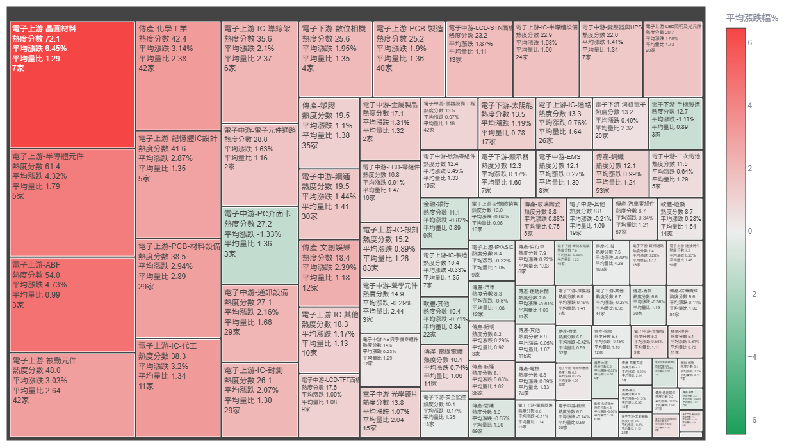
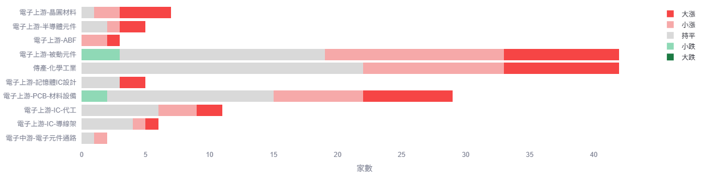
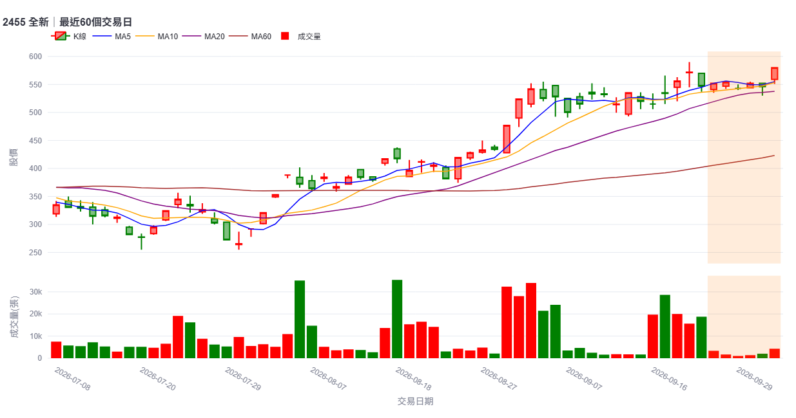
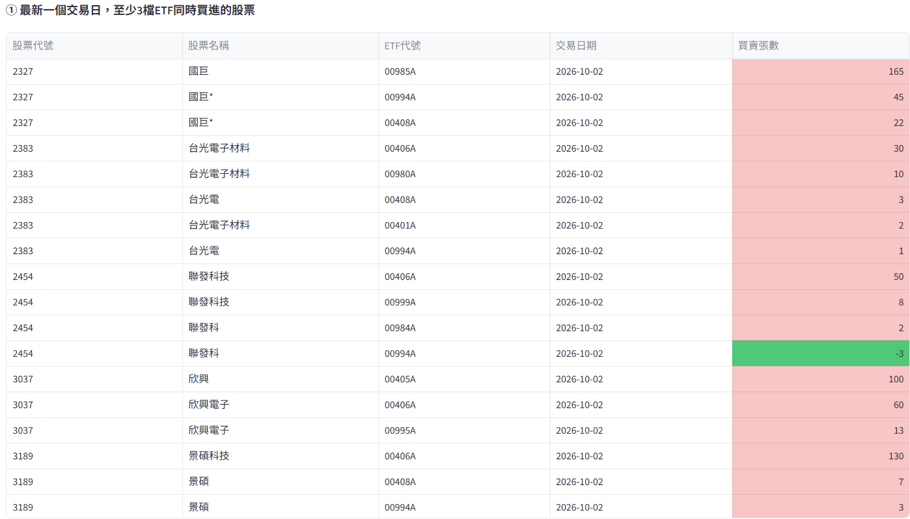

# 台股分析儀表板

個人使用的台灣股市分析 Streamlit 儀表板，把融資融券、三大法人、均線型態、主動式 ETF 持股、類股資金熱度、持股比例等資料集中在同一個介面，資料存放在 Supabase (PostgreSQL)。



## 目錄

- [專案簡介](#專案簡介)
- [功能](#功能)
- [技術棧](#技術棧)
- [專案結構](#專案結構)
- [安裝與執行](#安裝與執行)
- [使用方式](#使用方式)
- [部署(Streamlit Cloud)](#部署streamlit-cloud)
- [排程腳本(GitHub Actions)](#排程腳本github-actions)
- [使用上要注意的事](#使用上要注意的事)
- [資料來源與免責聲明](#資料來源與免責聲明)
- [授權](#授權)

## 專案簡介

**做什麼**：運用證交所、櫃買中心等公開資料做台股分析，並做成可用網址開啟、讓受邀者使用的網頁。

**解決的問題**：台股相關資料分散在證交所、櫃買中心、集保、CMoney 等不同來源，格式各異。本專案負責整理成統一的資料表，再讓使用者在同一個介面篩選、比較、看K線。

**特色**：

- 分析分頁涵蓋籌碼面、技術面與市場熱度。
- 今日討論度與處置股清單每個交易日台灣時間約 21:00 自動更新一次：由外部排程服務(cron-job.org)呼叫 GitHub API，觸發 GitHub Actions workflow 執行。
- 大表讀取採「版本鍵快取」，資料表最新日期沒變就不重查，壓低 Supabase 免費額度的 egress。
- 私有部署：只有受邀者能開啟 App，程式碼本身可以公開。

**開發上的挑戰**：CMoney 網站改版過、憑證驗證與 Python 3.13+ 不相容、Streamlit Cloud 與 GitHub Actions 都跑在 UTC 時區、GitHub Actions 內建的 cron 排程不穩定(曾完全沒有觸發)而改由外部排程器觸發，以及要把 Supabase egress 控制在免費額度內。對應的做法都記錄在「[使用上要注意的事](#使用上要注意的事)」。

## 功能

| 分頁 | 內容 | 主要資料表 |
| --- | --- | --- |
| 融資融券 | 找出融資減少、融券增加的股票 | `margin_trading_daily`、`margin_trading_otc_daily` |
| 三大法人 | 外資、投信、自營商買賣超與同時買賣超 | `three_institutional_daily` |
| 站穩均線 | 收盤價站穩 5 日、10 日、月線，且量能放大 | `stock_price_daily` |
| 均線糾結 | 5 日、10 日、月線互相靠攏的股票 | `stock_price_daily` |
| 均線糾結爆大量 | 均線糾結後突破前日高低點並爆量 | `stock_price_daily` |
| 下跌但法人同步買進 | 近期跌幅達門檻，且三大法人連續買超 | `stock_price_daily`、`three_institutional_daily` |
| 主動式ETF買賣 | 主動式 ETF 的持股變化與四個跨 ETF 分析 | `etf_master`、`etf_holdings_daily` |
| 資金與熱度 | 類股熱度 Treemap、漲跌家數分佈、今日討論度文字雲 | `sector_category_master`、`stock_price_daily`、`stock_mention_daily` |
| 持股比例 | 集保戶股權分散表的週變化：「大戶持股比例」(預設 10～15 級，每人持股 100 張以上)與「韭菜持股比例」(1～3 級，每人持股 10 張以下)，各自篩選兩週間持股比例變動 6%～15% 的股票，K 線圖合併顯示兩邊的結果 | `shareholding_distribution_weekly` |
| 損益計算 | 輸入買賣價、手續費折扣、張數，計算手續費、證交稅與淨損益，並顯示最低不賠賣出價(支援當沖、ETF 稅率) | 無(純計算) |
| 資料庫維護 | 各資料表保留最近 N 筆的刪除功能 | 全部 |

K 線圖會標示處置股的處置期間。各分頁的判斷條件與門檻，放在 `app/pages/` 下對應檔案裡的 `compute_*` 函式。

## 技術棧

| 技術 | 用途 |
| --- | --- |
| Python、Streamlit | 純 Python 建立互動式網頁介面，可直接部署到 Streamlit Community Cloud |
| Supabase (PostgreSQL) | 雲端資料庫，免費額度足夠個人使用，以 Session Pooler 連線 |
| pandas、SQLAlchemy、psycopg2 | 資料處理與資料庫存取 |
| Plotly | K 線圖、Treemap、長條圖 |
| wordcloud、Pillow | 今日討論度文字雲 |
| py_mini_racer | 執行 CMoney 頁面內嵌的 JavaScript 來解析類股與 token 資料 |
| GitHub Actions | 執行每日更新討論度與處置股的 workflow(支援手動與 API 觸發) |
| cron-job.org | 外部排程服務，每個交易日定時呼叫 GitHub API 觸發上述 workflow |

## 專案結構

```
analysis_app.py          # 入口：page config、CSS、側邊欄選單、頁面分派
schema.sql               # 所有資料表 DDL，只在 Supabase SQL Editor 手動執行一次
update_stock_mention.py  # 排程腳本：抓取 CMoney 討論度，寫入 stock_mention_daily
update_disposition.py    # 排程腳本：抓取上市／上櫃處置股清單，寫入 disposition_stocks
requirements.txt         # Python 套件(Streamlit Cloud 與 GitHub Actions 都會讀取)
packages.txt             # Streamlit Cloud 的系統套件(fonts-noto-cjk，文字雲中文字型用)
.env.example             # 本機環境變數範本
app/
  common/                # 共用工具(資料庫連線、HTTP、圖表、格式化、CMoney 解析等)
  pages/                 # 各功能頁面，一個檔案一個功能
.github/workflows/       # GitHub Actions workflow 設定(由外部排程器觸發)
```

## 安裝與執行

需要 Python 3.13 以上(本機開發)與一個 Supabase 專案。

1. 取得程式碼：`git clone <你的儲存庫網址>`，進入專案資料夾。
2. 在 Supabase 取得 **Session Pooler** 連線字串(本機網路不支援 IPv6 直連時必須用這個)。
3. 複製 `.env.example` 為 `.env`，填入 `DATABASE_URL`。
4. 到 Supabase SQL Editor 執行 `schema.sql` 建立所有資料表。
5. 安裝套件：`pip install -r requirements.txt`(建議先建立虛擬環境)。
6. 啟動：`streamlit run analysis_app.py`。

部署到 Streamlit Cloud 時，改在 App 的 Secrets 設定 `DATABASE_URL`，不需要 `.env`。

## 使用方式

1. 點左上角的選單按鈕展開側邊欄，選擇要看的分頁。
2. **第一次使用資料表是空的，需要先匯入資料**：
   - 融資融券、三大法人、站穩均線：分頁內的下載按鈕會從證交所、櫃買中心抓資料寫入資料庫(有每日下載次數限制)。
   - 持股比例：上傳集保公開的戶股權分散表 CSV。
   - 主動式ETF買賣：按「抓取今日持股」。
   - 資金與熱度：重新抓取類股對照表；今日討論度與處置股由排程更新。
3. 在各分頁設定條件，查看訊號清單，再選股票看 K 線。







## 部署(Streamlit Cloud)

1. 在 App Settings → Secrets 設定 `DATABASE_URL`(Session Pooler 連線字串)。
2. 在 Advanced settings 選擇 Python 版本。
3. repo 根目錄的 `packages.txt`(內容為 `fonts-noto-cjk`)會用 apt 安裝；沒有它的話，文字雲會退回只顯示股票代號，不會報錯。
4. 私有 App：Sharing 設定選 Only specific people can view this app，並邀請要使用的人。

## 排程腳本(GitHub Actions)

| 腳本 | Workflow | 觸發時間(台灣時間，週一至週五) |
| --- | --- | --- |
| `update_stock_mention.py` | `update_stock_mention.yml` | 約 21:00 |
| `update_disposition.py` | `update_disposition.yml` | 約 21:00 |

兩個 workflow 都需要在 repo 的 GitHub Secrets 設定 `DATABASE_URL`，也都支援 `workflow_dispatch`(可在 Actions 頁面手動觸發)。GitHub Actions 使用 Python 3.12。

**為什麼用外部排程器觸發**：GitHub Actions 內建的 `schedule` 不保證準時，也可能完全不建立執行紀錄(實際遇過：手動執行正常，但排程時間到了沒有任何動作)。因此改由外部服務 [cron-job.org](https://cron-job.org) 在每個交易日定時呼叫 GitHub API，觸發 `workflow_dispatch`。兩個 workflow 已移除 `schedule` 區塊，只保留 `workflow_dispatch`，避免與外部排程重複執行。

**cron-job.org 的設定(每個 workflow 各建立一個 job)**：

| 項目 | 設定 |
| --- | --- |
| URL | `https://api.github.com/repos/<帳號>/<repo名稱>/actions/workflows/<workflow檔名>/dispatches` |
| 方法 | `POST` |
| Request body | `{"ref":"main"}` |
| Headers | `Accept: application/vnd.github+json`、`Authorization: Bearer <token>`、`X-GitHub-Api-Version: 2022-11-28` |
| 排程 | Crontab `0 21 * * 1-5`，時區 `Asia/Taipei`(兩個 job 可相隔幾分鐘) |
| 成功回應 | HTTP 204(沒有內容) |

`<token>` 是 GitHub 的 fine-grained personal access token：Repository access 只選本專案，權限只開 **Actions: Read and write**。token 只存放在 cron-job.org 的 header 設定裡，**不要寫進程式碼、workflow 或 README**。token 過期後 cron-job.org 會收到 401，重新產生 token 並更新兩個 job 的 `Authorization` header 即可；建議開啟 cron-job.org 的失敗通知。

本機測試：

```
python update_stock_mention.py --dry-run          # 只印出結果，不寫入資料庫
python update_disposition.py --dry-run            # 只印出抓到的處置股
```

`update_disposition.py` 的上市、上櫃兩個來源互不影響：一邊失敗仍會處理另一邊，最後以非 0 狀態碼結束，讓 Actions 顯示失敗。

## 使用上要注意的事

**資料與資料庫**

- 所有資料表的建表語句都在 `schema.sql`，只需在 Supabase 手動執行一次，程式碼裡沒有任何自動建表。之後若改欄位，要同步修改 `schema.sql` 並到 Supabase 執行。
- 資料表都啟用了 Row Level Security 且沒有建立 policy，用來封鎖 Supabase 自動產生的 REST API。App 與排程腳本以資料表擁有者的身分直連，不受影響；如果所有頁面突然都沒資料，先檢查連線是否改用了非擁有者的角色。
- 股票代號一律只收 4 碼數字，會排除權證、牛熊證、TDR 等非一般股票。
- 「資料庫維護」分頁目前不限制權限，任何受邀者都能使用；刪除功能有「預覽影響範圍、勾選確認、才執行」兩道防呆。

**快取與資料更新**

- 大表讀取(股價、三大法人、融資融券)用「版本鍵快取」：呼叫前先查資料表最新日期，日期沒變就沿用快取，所以排程或匯入寫入新資料後會自動生效，不需要重啟 App。其餘頁面(持股比例、主動式ETF、處置股等)是 5 分鐘的短快取。
- Streamlit Cloud 與 GitHub Actions 都跑在 UTC。程式裡所有「今天」的判斷一律用 `app/common/constants.py` 的 `today_tw()`，不能用 `datetime.date.today()`。

**CMoney 相關**

- CMoney 憑證缺 Subject Key Identifier，會被 Python 3.13+ 擋下，所以所有對 cmoney.tw 的請求都必須用 `app/common/http.py` 的 `get_relaxed_session()`。
- 類股分類與討論度都是解析頁面內嵌的 `window.__NUXT__` 資料，改用 `deepFind()` 依鍵名搜尋而不是寫死路徑，因為 CMoney 改版過。若類股抓取突然失敗，先懷疑是網站再次改版。
- 討論度 API 與主動式 ETF 持股 API 都需要 CMoney 訪客 Bearer token(約 25 小時過期)，由 `app/common/cmoney.py` 的 `fetch_bearer_token()` 每次重新取得，不可存進資料庫。這些 API 沒有官方文件，格式隨時可能變動，某個功能突然失效時先檢查 API 回應。
- **今日討論度的涵蓋範圍是刻意的設計**：資料來自「熱門」feed，每天約 80～90 篇，不是全部貼文，冷門股可能完全不會出現。資料庫只保留當天統計，所以文字雲沒有日期篩選。

**資金與熱度的數值**

- 漲跌幅、振幅不是資料庫欄位，是現場以「昨日收盤價」為分母算出來的。
- 「昨日收盤價」會往前找最近一個收盤價不為空值的交易日；前一天成交量為 0 就繼續往前找。資料庫完全沒有更早的收盤價時，才會顯示 None。
- 當日成交量為 0 的股票，開盤價、收盤價、漲跌幅會是 None，分類為「持平」。

**其他**

- 文字雲或處置股突然不再更新時，依序檢查：cron-job.org 的執行紀錄(回應是否為 204；401 通常是 token 過期，403 是 token 權限不足)、GitHub Actions 頁面是否有 `workflow_dispatch` 觸發的執行紀錄、該次執行的 log。
- Streamlit Cloud 與 GitHub Actions 的伺服器都在海外，證交所、櫃買、集保、CMoney 是否會擋或限流，需部署後實測。

## 資料來源與免責聲明

資料來源：台灣證券交易所(TWSE)、證券櫃檯買賣中心(TPEx)、集中保管結算所(TDCC)、CMoney。資料著作權屬原提供單位。

本專案僅供個人研究與學習，所有分析結果不構成任何投資建議，使用者需自行承擔投資風險。

## 授權

本專案以 [MIT License](LICENSE) 授權。

作者：chen wei wu